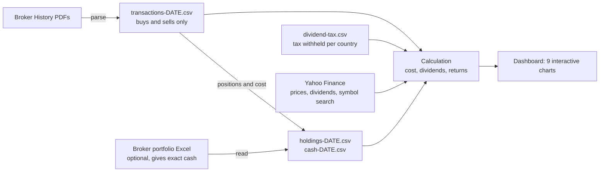

# Portfolio tracker

A personal investment dashboard, built in Python (Jupyter notebook). It reads the exports of a Belgian online broker (Keytrade), works out what you hold and what you **really** paid, pulls live prices from Yahoo Finance, and draws a full dashboard.

> I built this while learning Python, with Claude (Anthropic's AI assistant) helping me write and debug the code. I designed what the dashboard should show and made the decisions about the finance (costs, taxes, returns), and I went through how each part works. The commit history shows how the project grew.

## What it shows

- **Allocation:** by asset class (ETFs, equities, cash), by sector, by holding, and by currency.
- **Gains and losses:** per position, and capital kept vs gain vs dividends.
- **Performance over time:** return since purchase for each holding (interactive: zoom, period buttons, hourly prices), and every holding compared with the MSCI World ETF (IWDA), together with the portfolio as one line.
- **Risk:** correlation between holdings and volatility of each holding and of the portfolio.
- **Real returns:** cost uses the actual purchase date, fees and the exchange rate of the day; dividends are estimated from Yahoo's payouts after the taxes withheld; annualised return (XIRR) per holding and for the portfolio.

## How it works

1. **Ingestion:** the bank's French-language PDFs are parsed with a regular expression into a clean ledger of buys and sells. Each stock's Yahoo symbol is found from the name printed in the PDF. The Excel is recognised by its layout, not its name.
2. **Storage:** plain CSV files next to the notebook are the only state. Each step reads and writes them, so any step can be re-run alone.
3. **Calculation:** cost = amount paid (fees included) / exchange rate on the buy date. Dividends = Yahoo's payout x shares held on the ex-date x the share kept after tax at source and the Belgian 30% (a small editable table, which the code can correct from the dividend lines of the PDFs).
4. **Presentation:** one function per chart (Plotly), drawn in order by `show_dashboard`.

## Run it

1. Install Python 3.9+ and Jupyter (for example Anaconda, then JupyterLab).
2. Download this repository and open `portfolio_tracker.ipynb`.
3. Run the cells in order: install (then restart the kernel), setup, run.
4. **Try the demo first:** in the setup cell set `DOWNLOADS = "demo"`. The `demo/` folder holds fictional History PDFs and a portfolio Excel in the bank's format, so you can see everything working without a real account. Live prices come from Yahoo, so you need an internet connection.
5. For your own account, put your exports in your Downloads folder (History PDFs: one per stock you have bought; optionally the portfolio Excel) and follow "First time? Start here" at the top of the notebook.

## Privacy

Your own data (transactions, holdings, cash, exports) is never part of this repository: `.gitignore` keeps it out, and everything in `demo/` is invented.

## Limitations

Built for one broker's export format (French-language Keytrade Belgium files), EUR and USD only, and no support yet for partial sales or stock splits. Dividends are estimates, not statements.

## What I learned

Reading messy real-world files, calculating returns properly (cash flows, exchange rates, fees, XIRR), building interactive charts, and structuring a project so each part can be tested on its own.
